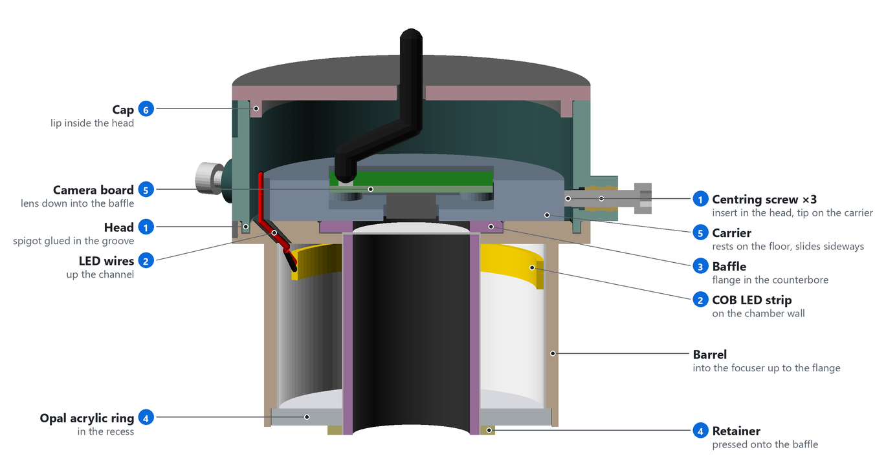
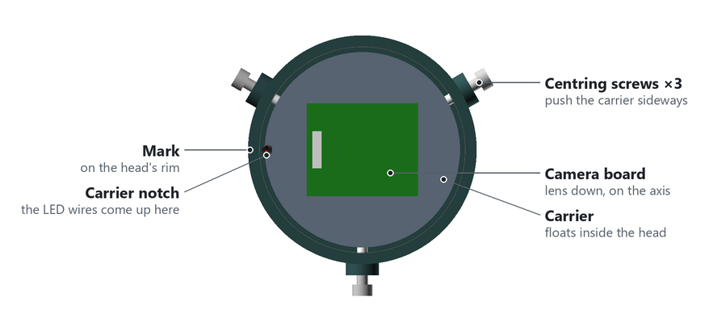

# ColliView 2" camera adapter

A 3D-printed 2" adapter that holds a USB camera module on the focuser axis, with a diffused LED
light ring around the lens. Everything is parametric in [`colliview_adapter.scad`](colliview_adapter.scad),
including the laser-cut acrylic diffuser, so all parts always match.

```
            cable + zip tie
        ┌──────── cap ────────┐
        │  trimmer, resistor  │   head: camera carrier pressed into the bore
        │ ┌─── carrier ─────┐ │◄─ (or floating, on 3 radial M3 centring screws)
        │ │ ▄▄▄ camera PCB  │ │
  ══════╧═╧══╤═ lens ═╤═════╧═╧══════  flange: seats on the focuser (sets tilt)
        │    │ baffle │    ▓│
        │    │ (black │    ▓│ ◄─ 5 V COB LED strip on the barrel wall
        │    │  bore) │     │    (white light chamber)
        │    │        │     │
        └▀▀▀▀┘        └▀▀▀▀▀┘ ◄─ opal acrylic ring, held by the retainer
              telescope side
```

## Camera

The default and only tested preset is `imx179_db05`: an IMX179 8 MP autofocus board with
`DB05-AF-8MP` on its silkscreen ([source](https://www.aliexpress.com/item/1005005334799549.html)).
Its measurements:

- A 28 × 28 × 1.12 mm PCB, with 2.5 mm holes on a 23 mm square.
- A centred voice-coil focus can, 8.46 × 8.46 × 4.5 mm.
- The connector's pins come through about 2.35 mm on the lens side. That clears the 3 mm stand-off;
  trim longer pins so the board sits flat.

Use a 4:3 mode, such as 3264×2448: 16:9 modes crop the vertical field.

**Field of view for another camera.** Measure `lens_to_rim` (the front of the lens to the far end of
the drawtube) and `rim_d` (the drawtube's inner diameter) on your focuser. The console then prints
`Required vertical FOV of the camera: >= N deg`. With the defaults that is 30°, so aim for a lens
with 35–45° vertical FOV. For a fixed-focus lens, set the focus to about 15–20 cm.

## Camera presets

A preset is one line in `preset()`:

```openscad
// [pcb [w, h, t], holes [x, y], holder [w, h], lens offset [x, y], lens body d, lens drop]
function preset(name) =
    name == "imx179_db05" ? [[28, 28, 1.12], [23, 23], [8.5, 8.5], [0, 0], 12, 4.6] :
    name == "custom" ? [custom_pcb, custom_holes, ...] :
    assert(false, ...);
```

| Field | Meaning |
|---|---|
| `pcb` | PCB width, height and thickness. |
| `holes` | Mounting-hole pitch. `[0, 0]` means no holes: the PCB then sits on corner pads in a pocket with a `fit_gap` clearance. |
| `holder` | The lens holder's footprint on the PCB. It is cut through the carrier floor. |
| `lens offset` | The lens centre relative to the PCB centre. The pocket shifts so the lens sits on the axis. |
| `lens body d` | The widest part of the lens or holder below the PCB (the diagonal, for a square one). It sizes the baffle. |
| `lens drop` | From the PCB's front face down to the front of the lens. It sets the lens height. |

To try a new board, set `camera = "custom"` and fill in the `custom_*` values, from the Customizer or with
`-D`. To keep it as a preset, add a line above the `custom` one and add its name to the `camera = ...; // [...]`
list. Measure the board with calipers rather than trusting listing photos. For a board with holes,
also set `pcb_insert` to suit its screws.

Asserts stop the export if the board doesn't fit: for example a lens that sticks out of the baffle, a
PCB boss that hits the lens holder, or the wire notch cutting into the pocket.

ColliView's jig defaults (16 / 44.4 / 6 / 100 mm) match the model's defaults. If the console's
`Centring jig: …` line shows other values, enter them under **Camera centring (jig) → Jig dimensions**.

## Light ring

- **Strip:** a 5 V COB strip, 4000 K, 4–5 mm wide, with a short cut unit. Its length is
  `led_unit × led_units` (default 5 × 25 mm), and the model checks that it fits the chamber.
  A 620 nm red strip is an option if you want to keep your night vision.
- **Power:** take it from the camera board's 5V and GND pads. Put 10 Ω (¼ W) and a 100 Ω trimmer
  in series, and set the current to 30–50 mA. At full brightness the strip would draw ~125 mA from
  the USB port's 500 mA budget.
- **Diffuser:** opal cast acrylic. 2 mm is brighter; 3 mm diffuses more evenly.

```
 camera board            head                         light chamber
 5V  ●──────── 10 Ω ──── 100 Ω trimmer ──┐
                                         ├── JST ──── + COB strip −
 GND ●───────────────────────────────────┘                     │
      └────────────────────────────────────────────────────────┘
```

## Export, print and cut

```sh
./build.sh                                   # needs openscad on PATH
.\build.ps1                                  # or set $env:OPENSCAD
.\build.ps1 -Extra '-D barrel_od=50.7'       # with overrides (./build.sh -D barrel_od=50.7)
```

These write `out/`:

| File | What |
|---|---|
| `tolerance_test.stl`, `fit_test.stl`, `cap_test.stl` | Print these first. Each test part is engraved with its value: set `barrel_od` to the ring that fits your focuser snugly, `fit_gap` to the ring the peg slides through without play, and `cap_squeeze` to the cap that holds firmly but still comes off. |
| `barrel_2mm.stl`, `barrel_3mm.stl` | Barrel, flange and head floor. Print the one that matches your acrylic. |
| `head.stl`, `carrier.stl`, `baffle.stl`, `retainer.stl`, `cap.stl` | The other parts, already in print orientation. |
| `jig.stl` | The centring jig. |
| `diffuser_{2,3}mm.{dxf,svg}` | The laser-cut ring. |

**Printing.** Use PETG or ASA, matte black, with 4 perimeters. Nothing needs supports.

- The barrel prints flange-down. The carrier seat and the flange face are the two faces that set the
  camera's tilt, which is why the barrel and head are separate parts. Remove any elephant's foot, so the
  carrier sits flat.
- `bed_chamfer` bevels fit edges that print on the bed.

**Carrier.** The default `carrier_fit = "fixed"` fills the head's bore with a `fixed_gap` (0.1 mm)
clearance, so the lens sits on the axis by itself, within about ±0.25 mm. With `"floating"`, the
carrier is smaller and is centred with three radial M3 screws. The head is the same for both.

**Inserts.** The screw holes are sized for [CNC Kitchen heat-set inserts][cnck]. `pcb_insert` (default
M2x3) sets the board's inserts, and `centring_insert` (default M3x5.7) the centring screws'. The console
prints which screws to buy.

**Laser.** Import the DXF in millimetres. The paths already include `kerf`, so turn off your laser
software's own offset. Measure your acrylic sheet and set `acrylic_t` to it before exporting the barrel.

[cnck]: https://cnckitchen.store/cdn/shop/files/table_metric.png

## Assembly




1. Glue the **head** onto the flange (CA or epoxy), with the marks lined up on the wire side. For the
   floating carrier, also fit M3 inserts and nylon-tipped screws.
2. Line the barrel's bore with white tape or paint. Stick the LED strip around the top of the chamber,
   and feed its wires up the sloped channel.
3. Blacken the **baffle's** bore and whiten its outside. Drop it in from the head into the counterbore.
4. Push the **acrylic ring** into the bottom recess, and press the **retainer** onto the baffle.
5. Melt M2 inserts into the carrier, screw on the board with the lens facing down, and press the
   carrier into the head with its notch at the mark. Solder the LED wires through the resistor and
   trimmer to 5V and GND. Keep the trimmer and plug clear of the head's wall, because the cap's lip
   reaches 5 mm down inside it.
6. Set the trimmer, push the cap in, and zip-tie the cable. To take the cap off, lever it out at its
   notches.



Set `part = "exploded"`, `"section"` or `"top_view"` to view these in OpenSCAD. `python make_figures.py`
(needs Pillow and NumPy) redraws the figures.

## Camera centring check

The circles follow the drawtube, so sensor offset and camera tilt don't matter. What matters is how
far the **lens** sits off the focuser axis: the primary ends up off by about half that offset, plus any
play of the barrel in the focuser. A tenth or two of a millimetre is fine at about f/5; faster mirrors
need less. Use a compression-ring focuser if you can.

`jig.stl` holds the adapter by its barrel. Its two holes on the axis line up, as seen through the
camera, when the lens is centred. The model prints its dimensions as `Centring jig: …`.

1. Stand the jig on a backlight, such as a phone screen, and put the adapter in.
2. In ColliView, open **Camera centring (jig)**. Click **Find aperture**, **Accept** the preview,
   and tick **Live**.
3. Loosen the board's screws and nudge it the way the arrow points, until the offset turns green
   (< 0.05 mm). Then tighten the screws and check again. Some cameras mirror the image, so check the
   arrow's direction with a small nudge first.
4. Turn the adapter 180° and average the two readings: that cancels any print error in the jig.

**Focuser checks.** If the centre spot jumps when you rack or lock the focuser, the drawtube moves
sideways. That counts in full, like barrel play. Focuser tilt rarely needs fixing, because the
secondary makes up for it.

## Sources

- IMX179 AF module (`DB05-AF-8MP`): <https://www.aliexpress.com/item/1005005334799549.html>
- Opal acrylic: <https://www.perspex.co.uk/materials/perspex-cast-acrylic/opal-white/>
- CNC Kitchen heat-set inserts: <https://cnckitchen.store/cdn/shop/files/table_metric.png>
